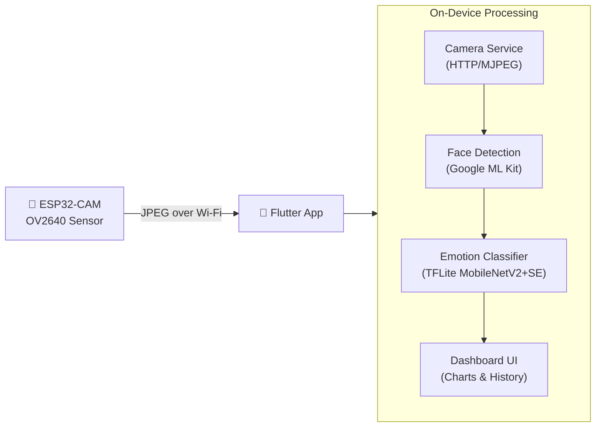

<p align="center">
  <h1 align="center">🎭 EmoLens</h1>
  <p align="center"><strong>Live Emotion Recognition for Individuals with Down Syndrome</strong></p>
</p>

<p align="center">
  
  
  
  
  
</p>

---

## Table of Contents

- [Overview](#overview)
- [Motivation](#motivation)
- [Architecture](#architecture)
- [Project Structure](#project-structure)
- [Prerequisites](#prerequisites)
- [Setup Instructions](#setup-instructions)
- [Usage](#usage)
- [Model Details](#model-details)
- [Adaptive Learning](#adaptive-learning)
- [Privacy & Ethics](#privacy--ethics)
- [Troubleshooting](#troubleshooting)
- [Documentation](#documentation)
- [License](#license)
- [Contributors](#contributors)

---

## Overview

**EmoLens** is a mobile application that connects over Wi-Fi to an ESP32-CAM module, pulls live video frames, detects faces, and classifies emotions — **Happy**, **Neutral**, or **Sad** — in real time. The system is specifically designed and trained for individuals with Down syndrome, whose unique facial features can challenge general-purpose emotion recognition models.

All inference runs **entirely on-device** using a TensorFlow Lite model, ensuring that no images ever leave the phone.

## Motivation

Emotion recognition for individuals with Down syndrome is an underserved area in assistive technology. Standard facial expression datasets and models often fail to generalize to the distinct facial morphology associated with Down syndrome. EmoLens addresses this gap by:

1. **Training on a dedicated dataset** of facial expressions from individuals with Down syndrome.
2. **Using transfer learning** with attention mechanisms to capture subtle expression cues.
3. **Supporting adaptive personalization** so caregivers can improve accuracy for a specific individual over time.
4. **Prioritizing privacy** — all processing is on-device, with no cloud dependency.

## Architecture



> For detailed architecture diagrams, see [docs/architecture.md](docs/architecture.md).

## Project Structure

```
Capstone/
├── README.md                        # This file
├── app/                             # Flutter mobile application
│   ├── lib/
│   │   ├── main.dart                # App entry point
│   │   ├── core/                    # Theme, constants, utilities
│   │   ├── data/                    # Repositories, data sources, models
│   │   ├── domain/                  # Entities, use cases
│   │   ├── presentation/           # Screens, widgets, providers
│   │   └── services/               # Camera, TFLite, face detection services
│   ├── assets/
│   │   └── models/
│   │       ├── emotion_model.tflite # Quantized emotion classifier
│   │       └── labels.txt           # Class labels (Happy, Neutral, Sad)
│   ├── test/                        # Unit and widget tests
│   ├── pubspec.yaml
│   └── android/
├── ml/                              # Machine learning pipeline
│   ├── requirements.txt             # Python dependencies
│   ├── train.py                     # Training script (Baseline CNN + MobileNetV2+SE)
│   ├── evaluate.py                  # Evaluation, plots, Grad-CAM
│   ├── export_tflite.py             # TFLite conversion & verification
│   ├── collect_from_esp32.py        # Data collection from live ESP32-CAM
│   ├── mock_esp32_server.py         # Mock ESP32 server for testing
│   ├── adaptive_personalization.py  # Adaptive fine-tuning helper
│   ├── saved_models/                # Trained Keras models
│   └── README.md                    # ML pipeline documentation
├── cam/                             # ESP32-CAM firmware (Arduino)
│   ├── cam.ino                      # Main sketch
│   ├── app_httpd.cpp                # HTTP server handlers
│   ├── camera_pins.h                # Pin definitions per board
│   ├── board_config.h               # Board configuration
│   ├── camera_index.h               # Web UI index
│   ├── partitions.csv               # Flash partition table
│   └── ci.yml                       # CI configuration
├── dataset/                         # Training data
│   └── downSyndrome/
│       ├── Happy/                   # 836 images
│       ├── Neutral/                 # 581 images
│       └── Sad/                     # 83 images
└── docs/                            # Project documentation
    ├── architecture.md              # System & ML architecture
    ├── model_report.md              # Model training report
    ├── privacy_policy.md            # Privacy policy
    └── results/                     # Evaluation plots & metrics
        ├── confusion_matrix.png
        ├── roc_curves.png
        ├── pr_curves.png
        ├── training_history.png
        ├── gradcam_samples.png
        └── classification_report.txt
```

## Prerequisites

| Requirement | Version | Purpose |
|---|---|---|
| **Flutter SDK** | 3.x+ | Build the mobile app |
| **Dart** | 3.x+ | Included with Flutter |
| **Android Studio** | Latest | Android SDK, emulator, device tools |
| **Python** | 3.9+ | ML training pipeline |
| **pip** | Latest | Python package management |
| **Arduino IDE** | 2.x+ | Flash ESP32-CAM firmware |
| **ESP32-CAM** | AI-Thinker (OV2640) | Camera hardware module |
| **USB-to-Serial Adapter** | FTDI / CP2102 | Flash firmware to ESP32-CAM |

## Setup Instructions

### 1. ESP32-CAM Firmware

1. **Install Arduino IDE** and add the ESP32 board package:
   - Go to **File → Preferences** → Board Manager URLs, add:
     ```
     https://raw.githubusercontent.com/espressif/arduino-esp32/gh-pages/package_esp32_index.json
     ```
   - Open **Tools → Board → Board Manager**, search `esp32`, and install.

2. **Open the firmware sketch**:
   ```
   File → Open → Capstone/cam/cam.ino
   ```

3. **Configure the board**:
   - Board: `AI Thinker ESP32-CAM`
   - Partition Scheme: `Huge APP (3MB No OTA / 1MB SPIFFS)`
   - Upload Speed: `115200`

4. **Enter your Wi-Fi credentials** in `cam.ino`:
   ```cpp
   const char* ssid = "YOUR_WIFI_SSID";
   const char* password = "YOUR_WIFI_PASSWORD";
   ```

5. **Flash the firmware**:
   - Connect the USB-to-Serial adapter (GPIO 0 → GND for flash mode).
   - Click **Upload**.
   - After upload, disconnect GPIO 0 from GND and press **RST**.

6. **Verify**:
   - Open **Serial Monitor** at 115200 baud.
   - Note the IP address printed (e.g., `Camera Ready! Use 'http://<IP>/' to connect`).
   - Open `http://<IP>/` in a browser — you should see the camera stream UI.

### 2. ML Pipeline

```bash
cd ml
pip install -r requirements.txt

# Train models (Baseline CNN + MobileNetV2+SE)
python train.py

# Evaluate and generate plots
python evaluate.py

# Export to TFLite for mobile deployment
python export_tflite.py
```

> **Note:** Training will auto-detect GPU (CUDA) and fall back to CPU if unavailable. GPU is recommended for reasonable training times.

### 3. Flutter App

```bash
cd app
flutter pub get
flutter build apk --release
```

The release APK will be at `app/build/app/outputs/flutter-apk/app-release.apk`.

Install on your Android device:
```bash
flutter install
```

### 4. Connect the App to ESP32-CAM

1. Ensure your **phone and ESP32-CAM are on the same Wi-Fi network**.
2. Open the EmoLens app.
3. Go to **Settings** (gear icon).
4. Enter the ESP32-CAM IP address (from Serial Monitor).
5. Tap **Test Connection** to verify.
6. Return to the main screen and start the live feed.

## Usage

### Live Emotion Recognition

1. Launch the app and ensure the ESP32-CAM connection is active.
2. Point the camera at the individual's face.
3. The app will automatically detect faces and classify emotions in real time.
4. View the emotion timeline and session statistics on the **Dashboard**.

### Mock Server (No Hardware Required)

For development and testing without an ESP32-CAM:

```bash
python ml/mock_esp32_server.py --port 80
```

This starts a local server that mimics the ESP32-CAM HTTP endpoints, serving random images from the dataset. Use `127.0.0.1` (or your computer's local IP) as the camera IP in the app.

### Data Collection

Collect new labeled images directly from the ESP32-CAM for retraining:

```bash
python ml/collect_from_esp32.py --ip <IP> --label Happy --output dataset/collected/
python ml/collect_from_esp32.py --ip <IP> --label Neutral --output dataset/collected/
python ml/collect_from_esp32.py --ip <IP> --label Sad --output dataset/collected/
```

Press `Ctrl+C` to stop collection. Images are saved with timestamps to labeled subdirectories.

## Model Details

### Architecture

EmoLens uses a **MobileNetV2** backbone with a **Squeeze-and-Excitation (SE) attention block** for emotion classification:

| Component | Details |
|---|---|
| **Backbone** | MobileNetV2 (ImageNet pre-trained) |
| **Attention** | Squeeze-and-Excitation (SE) block |
| **Head** | GAP → Dropout(0.3) → Dense(128, ReLU) → Dropout(0.2) → Dense(3, Softmax) |
| **Input** | 224 × 224 × 3 (RGB) |
| **Output** | 3 classes — Happy, Neutral, Sad |
| **Preprocessing** | Normalize pixels to **[-1, 1]** via `mobilenet_v2.preprocess_input` |

### Training Strategy

- **Phase 1 (20 epochs):** Freeze backbone, train only the SE block and classification head.
- **Phase 2 (30 epochs):** Unfreeze top 30 layers of MobileNetV2, fine-tune end-to-end with a reduced learning rate (`1e-5`).
- **Loss:** Focal loss with computed class weights to handle severe class imbalance (Happy: 836, Neutral: 581, Sad: 83).
- **Augmentation:** Heavy augmentation on the minority class (Sad) — flips, rotation, brightness/contrast jitter, zoom, blur, noise, JPEG compression artifacts, and low-resolution downscaling to simulate ESP32-CAM OV2640 image quality.

> For the full model report, see [docs/model_report.md](docs/model_report.md).

## Adaptive Learning

EmoLens supports **on-device adaptive personalization**:

1. During live sessions, caregivers can **correct** misclassified emotions by tapping the predicted label and selecting the correct one.
2. Corrected face crops and labels are **stored locally** on the device.
3. These corrections can be exported and used to **fine-tune** the last classification layers of the model, creating a personalized model that better recognizes a specific individual's expressions.

```bash
# Fine-tune with collected corrections
python ml/adaptive_personalization.py --data corrections/ --base-model ml/saved_models/best_model.keras
```

> **Limitations:** Adaptive learning fine-tunes only the final layers to minimize catastrophic forgetting. With very few samples, improvements may be modest. See [docs/model_report.md](docs/model_report.md#limitations-and-future-work) for details.

## Privacy & Ethics

> **EmoLens is designed with privacy as a core principle.**

- ✅ **All processing is on-device** — emotion classification runs entirely on the phone using TFLite.
- ✅ **No images are transmitted** — frames are pulled from the ESP32-CAM over local Wi-Fi and never leave the device.
- ✅ **No cloud dependency** — the app works fully offline after initial setup.
- ✅ **Camera images are not stored** unless explicitly saved by the caregiver.
- ✅ **Vulnerable population protections** — individuals with Down syndrome are a vulnerable population; **informed caregiver consent is required** before use.
- ✅ **No biometric data collection** — the system does not perform identity recognition or store facial templates.

> For the full privacy policy, see [docs/privacy_policy.md](docs/privacy_policy.md).

## Troubleshooting

### "Can't connect to ESP32-CAM"

- Ensure the **phone and ESP32-CAM are on the same Wi-Fi network**.
- Check that the ESP32-CAM IP is correct (verify via Serial Monitor).
- Disable any **firewall** rules blocking local network traffic.
- If using a **mobile hotspot**, ensure client isolation is disabled (some hotspots block device-to-device communication).
- Try accessing `http://<IP>/` from a browser on the same network first.

### ESP32-CAM Brownout / Reboot Loop

- Use a **quality 5V / 2A power supply** — the ESP32-CAM draws significant current during Wi-Fi transmission.
- Use a **short, thick USB cable** (< 1 meter) to minimize voltage drop.
- If using an FTDI adapter for power, it may not supply enough current — use a dedicated power source.

### Low FPS / Laggy Stream

- In the app **Settings**, reduce the **camera resolution** (e.g., QVGA 320×240).
- Switch to **Capture Polling mode** instead of MJPEG streaming (more reliable on constrained networks).
- Ensure no other devices are heavily using the same Wi-Fi network.
- Move the phone closer to the ESP32-CAM / Wi-Fi router.

### Low Model Accuracy

- The pre-trained model is a general model for Down syndrome expressions. For best results with a specific individual, **collect labeled data** using `collect_from_esp32.py` and **retrain** the model.
- Ensure good, even lighting — avoid harsh backlighting or shadows.
- Position the face within the frame at a reasonable distance (not too far, not too close).
- Use the **adaptive learning** feature to let caregivers correct misclassifications over time.

## Documentation

| Document | Description |
|---|---|
| [Architecture](docs/architecture.md) | System, ML pipeline, and app architecture diagrams |
| [Model Report](docs/model_report.md) | Dataset, training methodology, evaluation results |
| [Privacy Policy](docs/privacy_policy.md) | Privacy and ethical considerations |
| [ML Pipeline README](ml/README.md) | ML pipeline usage instructions |

## License

This project is developed as a capstone project. All rights reserved.

> **Dataset Notice:** The Down Syndrome emotion dataset used for training is used for academic research purposes only.

## Contributors

| Name | Role |
|---|---|
| *Your Name* | Developer — ML Pipeline, Flutter App, ESP32 Integration |
| *Advisor Name* | Project Advisor |

---

<p align="center">
  <em>EmoLens — Making emotion recognition accessible and inclusive.</em>
</p>
