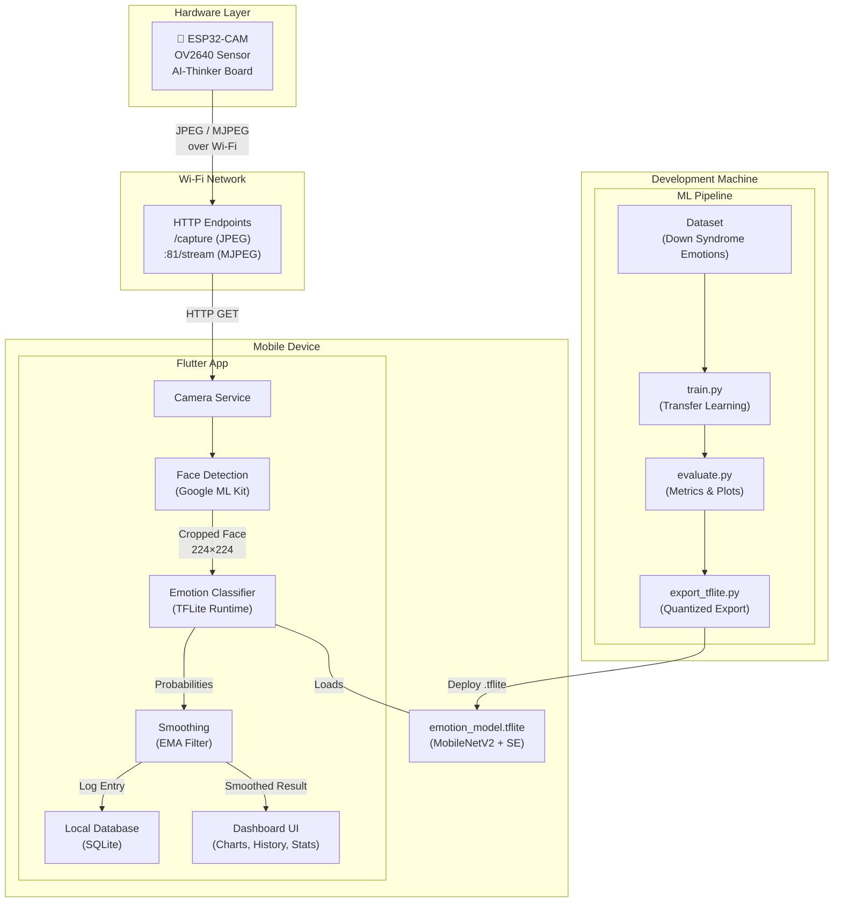
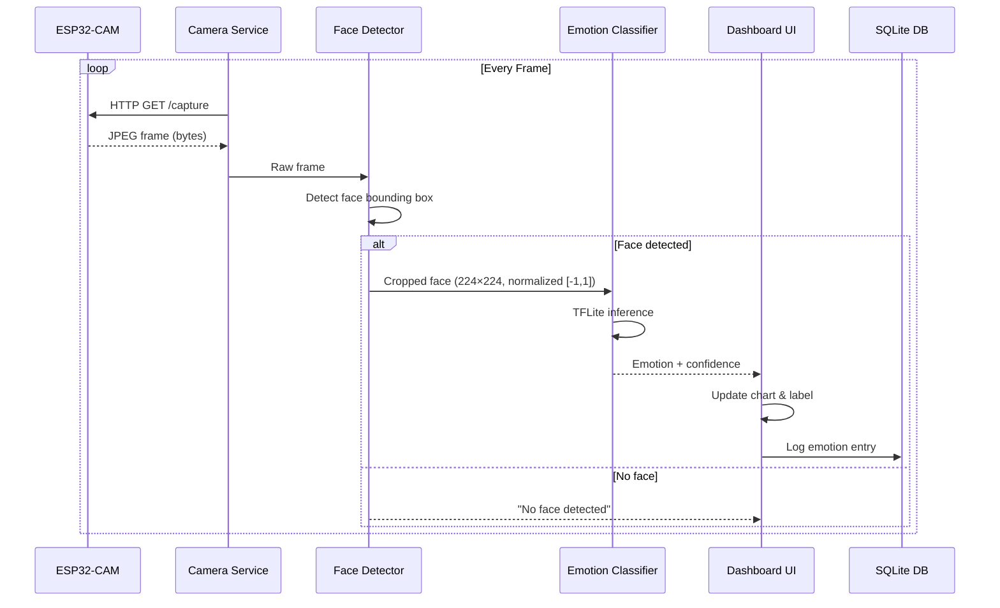
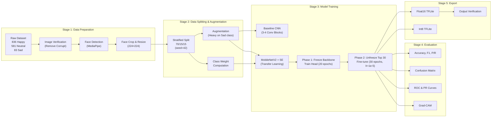
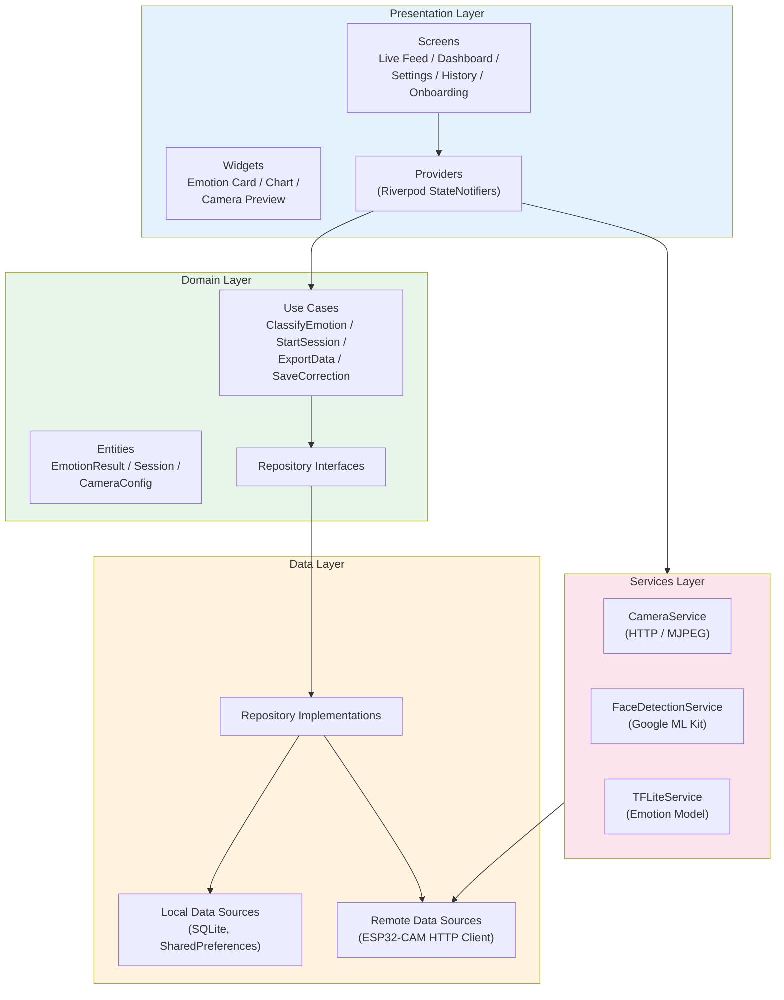
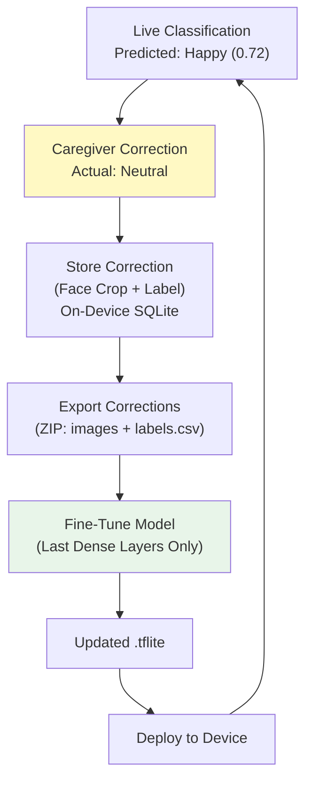

# EmoLens — System Architecture

This document describes the architecture of EmoLens at three levels: the overall system, the ML training pipeline, and the Flutter mobile application.

---

## Table of Contents

- [1. System Architecture](#1-system-architecture)
- [2. Data Flow Overview](#2-data-flow-overview)
- [3. ML Pipeline Architecture](#3-ml-pipeline-architecture)
- [4. App Architecture (Clean Architecture)](#4-app-architecture-clean-architecture)
- [5. Adaptive Learning Flow](#5-adaptive-learning-flow)
- [6. Network Communication](#6-network-communication)

---

## 1. System Architecture

The EmoLens system consists of three major subsystems: the **ESP32-CAM** hardware module, the **ML training pipeline** (offline, on a development machine), and the **Flutter mobile app** (on-device inference).



### Component Summary

| Component | Technology | Responsibility |
|---|---|---|
| ESP32-CAM | Arduino / C++ | Capture and serve JPEG frames over HTTP |
| Camera Service | Dart (http package) | Pull frames via HTTP GET or parse MJPEG stream |
| Face Detection | Google ML Kit | Detect and crop face regions from frames |
| Emotion Classifier | TFLite (MobileNetV2+SE) | Classify cropped face as Happy / Neutral / Sad |
| Smoothing | EMA Filter | Temporal smoothing to reduce prediction jitter |
| Local Database | SQLite (sqflite) | Store session history, emotion logs, corrections |
| Dashboard UI | Flutter (Riverpod, fl_chart) | Real-time display, charts, session management |
| ML Pipeline | Python (TensorFlow, MediaPipe) | Train, evaluate, and export the emotion model |

---

## 2. Data Flow Overview

### Real-Time Inference Flow



### Data Processing Modes

The app supports two frame acquisition modes:

| Mode | Endpoint | Description |
|---|---|---|
| **Capture Polling** | `GET http://<IP>/capture` | Requests individual JPEG frames at a configurable interval. More reliable on constrained networks. |
| **MJPEG Streaming** | `GET http://<IP>:81/stream` | Continuous MJPEG stream. Lower latency but higher bandwidth usage. Uses boundary-based frame parsing. |

---

## 3. ML Pipeline Architecture

The ML pipeline transforms raw images into a deployable TFLite model through five stages.



### Augmentation Strategy

Due to severe class imbalance (Happy 836 : Neutral 581 : **Sad 83**), heavy augmentation is applied, particularly to the minority class:

| Augmentation | Purpose |
|---|---|
| Horizontal flip | Mirror invariance |
| Rotation (±15°) | Pose variation |
| Brightness / contrast jitter | Lighting robustness |
| Random zoom | Scale invariance |
| Gaussian blur / noise | Sensor noise simulation |
| JPEG compression artifacts | Simulate ESP32-CAM OV2640 image quality |
| Low-resolution downscale | Simulate real-world camera resolution |

### Preprocessing

> **Critical:** The Flutter app must replicate this preprocessing exactly.

```
Input image → Resize to 224×224 → Convert to float32 → Normalize to [-1, 1]
```

Normalization uses `tf.keras.applications.mobilenet_v2.preprocess_input`, which maps pixel values from `[0, 255]` to `[-1, 1]` using the formula: `pixel / 127.5 - 1.0`.

---

## 4. App Architecture (Clean Architecture)

The Flutter app follows **Clean Architecture** principles with clear separation of concerns.



### Layer Responsibilities

| Layer | Responsibility | Key Classes |
|---|---|---|
| **Presentation** | UI rendering, user interaction, state management | Screens, Widgets, Riverpod Providers |
| **Domain** | Business logic, entities, use case orchestration | EmotionResult, ClassifyEmotionUseCase |
| **Data** | Data persistence, network communication | SQLite repositories, HTTP clients |
| **Services** | Hardware abstraction, ML inference | CameraService, TFLiteService, FaceDetectionService |

### Navigation

The app uses **GoRouter** for declarative routing:

```
/onboarding → /settings → /live-feed → /dashboard → /history
                              ↕
                          /session/:id
```

---

## 5. Adaptive Learning Flow

EmoLens supports caregiver-driven adaptive personalization to improve accuracy for a specific individual.



### Adaptive Learning Details

| Aspect | Detail |
|---|---|
| **What is stored** | Cropped face image (224×224) + correct label |
| **Where** | On-device in app-private storage |
| **Fine-tuning scope** | Only the final Dense layers (to prevent catastrophic forgetting) |
| **Tool** | `ml/adaptive_personalization.py` |
| **Limitations** | Small correction set may yield modest gains; no identity-aware training |

---

## 6. Network Communication

### ESP32-CAM HTTP Endpoints

| Endpoint | Method | Description |
|---|---|---|
| `http://<IP>/capture` | GET | Returns a single JPEG frame |
| `http://<IP>:81/stream` | GET | Returns a continuous MJPEG stream |
| `http://<IP>/status` | GET | Returns camera status JSON |
| `http://<IP>/control?var=<name>&val=<value>` | GET | Set camera parameter (resolution, quality, etc.) |

### MJPEG Stream Format

The MJPEG stream uses the boundary string `123456789000000000000987654321`:

```
--123456789000000000000987654321\r\n
Content-Type: image/jpeg\r\n
Content-Length: <size>\r\n
\r\n
<JPEG bytes>
```

The app's stream parser reads frames by scanning for boundary markers and extracting JPEG payloads between them.

---

> **See also:**
> - [Model Report](model_report.md) — Training methodology and evaluation results
> - [Privacy Policy](privacy_policy.md) — Data handling and ethical considerations
> - [Root README](../README.md) — Setup and usage instructions
