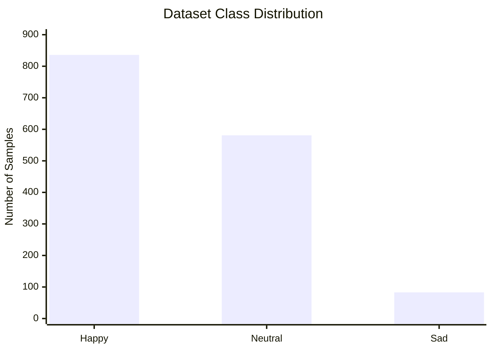
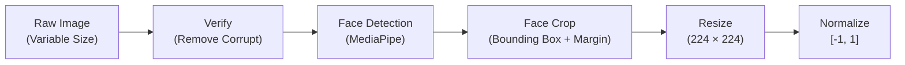
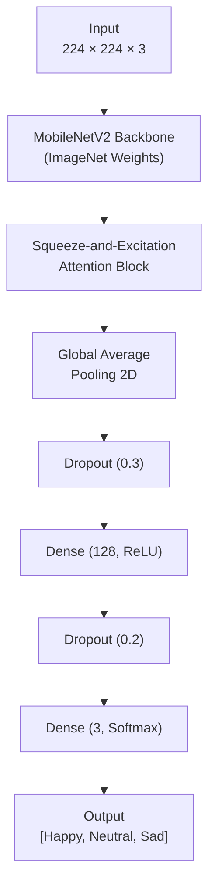

# EmoLens — Model Training Report

This report documents the dataset, training methodology, evaluation metrics, and deployment details for the EmoLens emotion classification model.

---

## Table of Contents

- [1. Dataset Description](#1-dataset-description)
- [2. Data Preprocessing](#2-data-preprocessing)
- [3. Training Methodology](#3-training-methodology)
- [4. Model Architectures](#4-model-architectures)
- [5. Evaluation Results](#5-evaluation-results)
- [6. Model Comparison](#6-model-comparison)
- [7. TFLite Conversion & Verification](#7-tflite-conversion--verification)
- [8. Limitations & Future Work](#8-limitations--future-work)

---

## 1. Dataset Description

### Source

The dataset consists of facial images of individuals with Down syndrome, manually labeled into three emotion categories.

### Class Distribution

| Class | Samples | Percentage |
|---|---|---|
| Happy | 836 | 55.7% |
| Neutral | 581 | 38.7% |
| Sad | 83 | 5.5% |
| **Total** | **1,500** | **100%** |



### Key Observations

- **Severe class imbalance:** The Sad class contains only 83 samples (~5.5%), roughly 10× fewer than Happy. This necessitates aggressive augmentation and class-weighted loss functions.
- **Unique facial features:** Individuals with Down syndrome have distinctive facial morphology (flattened nasal bridge, epicanthal folds, smaller mid-face), which general-purpose FER models are not trained to handle.
- **Potential identity leakage:** Without subject identity metadata, the stratified split may assign different expressions of the same individual to both train and test sets. This is a known limitation.

### Data Split

| Set | Ratio | Purpose |
|---|---|---|
| Training | 70% | Model training with augmentation |
| Validation | 15% | Hyperparameter tuning and early stopping |
| Test | 15% | Final evaluation (untouched during training) |

Split is **stratified** by class with `seed=42` for reproducibility.

---

## 2. Data Preprocessing

### Pipeline



### Steps

1. **Image Verification:** Corrupt or unreadable images are detected and removed.
2. **Face Detection:** MediaPipe FaceDetection is used to locate faces. Images with no detected face are logged and skipped.
3. **Face Cropping:** The detected bounding box is expanded with a small margin and cropped.
4. **Resizing:** Cropped faces are resized to **224 × 224** pixels (MobileNetV2 input size).
5. **Normalization:** Pixel values are normalized from `[0, 255]` to **`[-1, 1]`** using `tf.keras.applications.mobilenet_v2.preprocess_input` (formula: `pixel / 127.5 - 1.0`).

> ⚠️ **The Flutter app must replicate this exact normalization.** Using `[0, 1]` normalization instead of `[-1, 1]` will produce incorrect predictions.

### Augmentation (Training Only)

Standard augmentations are applied to all classes, with **heavy augmentation** for the Sad minority class:

| Augmentation | All Classes | Sad (Extra) |
|---|---|---|
| Horizontal flip | ✅ | ✅ |
| Rotation ±15° | ✅ | ✅ |
| Brightness / contrast jitter | ✅ | ✅ |
| Random zoom (0.8–1.2) | ✅ | ✅ |
| Gaussian blur | — | ✅ |
| Gaussian noise | — | ✅ |
| JPEG compression artifacts | — | ✅ |
| Low-resolution downscale | — | ✅ |

The ESP32-CAM-specific augmentations (JPEG artifacts, low-resolution downscale) are designed to simulate the OV2640 sensor image quality, improving domain transfer from dataset to real-world deployment.

---

## 3. Training Methodology

### Approach: Two-Phase Transfer Learning

1. **Phase 1 — Feature Extraction (20 epochs):**
   - MobileNetV2 backbone is **frozen** (pre-trained ImageNet weights).
   - Only the SE attention block and classification head are trained.
   - Learning rate: `1e-3` (Adam optimizer).

2. **Phase 2 — Fine-Tuning (30 epochs):**
   - Top 30 layers of MobileNetV2 are **unfrozen**.
   - End-to-end fine-tuning with a reduced learning rate: `1e-5`.
   - This allows the model to adapt lower-level features to Down syndrome facial morphology.

### Loss Function

**Focal Loss** is used to address class imbalance:

```
FL(p_t) = -α_t · (1 - p_t)^γ · log(p_t)
```

Where `γ = 2.0` focuses learning on hard-to-classify samples, and `α_t` is the per-class weight inversely proportional to class frequency.

### Class Weights

Computed inversely proportional to class frequency:

| Class | Frequency | Weight (approx.) |
|---|---|---|
| Happy | 836 (55.7%) | ~0.60 |
| Neutral | 581 (38.7%) | ~0.86 |
| Sad | 83 (5.5%) | ~6.02 |

### Training Callbacks

| Callback | Configuration |
|---|---|
| **ReduceLROnPlateau** | Monitor `val_loss`, factor=0.5, patience=5 |
| **EarlyStopping** | Monitor `val_loss`, patience=10, restore best weights |
| **ModelCheckpoint** | Save best model by `val_loss` to `ml/saved_models/` |

### Reproducibility

All random seeds are set to `42` (Python, NumPy, TensorFlow) for reproducible results.

---

## 4. Model Architectures

### Model A: Baseline CNN

A simple custom CNN for comparison purposes:

| Layer | Output Shape |
|---|---|
| Conv2D(32, 3×3) + ReLU + MaxPool | 112 × 112 × 32 |
| Conv2D(64, 3×3) + ReLU + MaxPool | 56 × 56 × 64 |
| Conv2D(128, 3×3) + ReLU + MaxPool | 28 × 28 × 128 |
| Conv2D(256, 3×3) + ReLU + MaxPool | 14 × 14 × 256 |
| GlobalAveragePooling2D | 256 |
| Dense(128, ReLU) + Dropout(0.5) | 128 |
| Dense(3, Softmax) | 3 |

### Model B: MobileNetV2 + SE Attention (Primary Model)



#### Squeeze-and-Excitation (SE) Block

The SE block adaptively recalibrates channel-wise feature responses:

1. **Squeeze:** Global Average Pooling compresses spatial dimensions to a channel descriptor.
2. **Excitation:** Two Dense layers (reduction ratio = 16) learn channel-wise attention weights.
3. **Scale:** Channel attention weights are multiplied element-wise with the original feature map.

This allows the model to emphasize the most informative feature channels for emotion-relevant facial regions (e.g., mouth curvature, eye shape).

---

## 5. Evaluation Results

### Primary Metric

**Macro-averaged F1-score** is the primary evaluation metric, as it accounts for class imbalance by weighting all classes equally regardless of their frequency.

### Generated Evaluation Outputs

The evaluation pipeline (`evaluate.py`) generates the following artifacts in `docs/results/`:

| File | Description |
|---|---|
| `confusion_matrix.png` | Heatmap of predicted vs. actual classes |
| `roc_curves.png` | One-vs-rest ROC curves with AUC for each class |
| `pr_curves.png` | Precision-Recall curves for each class |
| `training_history.png` | Loss and accuracy curves over training epochs |
| `gradcam_samples.png` | Grad-CAM attention visualizations (3 samples per class) |
| `classification_report.txt` | Full precision / recall / F1 per class + macro averages |

### Metrics Summary

> **Note:** The table below will be populated after running `evaluate.py`. See `docs/results/classification_report.txt` for full results.

| Metric | Baseline CNN | MobileNetV2 + SE |
|---|---|---|
| **Overall Accuracy** | — | — |
| **Macro F1-Score** | — | — |
| Happy Precision | — | — |
| Happy Recall | — | — |
| Happy F1 | — | — |
| Neutral Precision | — | — |
| Neutral Recall | — | — |
| Neutral F1 | — | — |
| Sad Precision | — | — |
| Sad Recall | — | — |
| Sad F1 | — | — |

### Confusion Matrix

> See [`docs/results/confusion_matrix.png`](results/confusion_matrix.png) for the full confusion matrix heatmap.

### ROC Curves

> See [`docs/results/roc_curves.png`](results/roc_curves.png) for one-vs-rest ROC curves.

### Precision-Recall Curves

> See [`docs/results/pr_curves.png`](results/pr_curves.png) for precision-recall curves.

### Training History

> See [`docs/results/training_history.png`](results/training_history.png) for loss and accuracy over epochs.

### Grad-CAM Visualizations

> See [`docs/results/gradcam_samples.png`](results/gradcam_samples.png) for attention heatmap overlays.

Grad-CAM visualizations show which facial regions the model attends to for each emotion:
- **Happy:** Expected focus on mouth region (smile) and cheeks.
- **Neutral:** More distributed attention across the face.
- **Sad:** Expected focus on mouth corners (downturn) and brow region.

---

## 6. Model Comparison

| Aspect | Baseline CNN | MobileNetV2 + SE |
|---|---|---|
| **Parameters** | ~1.5M | ~3.5M (with SE + head) |
| **Pre-training** | None (from scratch) | ImageNet (transfer learning) |
| **Attention** | None | Squeeze-and-Excitation |
| **Training strategy** | Single phase | Two-phase (freeze → fine-tune) |
| **Loss** | Categorical cross-entropy | Focal loss with class weights |
| **Expected advantage** | Faster training, simpler | Higher accuracy on imbalanced data |
| **TFLite size** | < 5 MB | < 10 MB |
| **Inference speed** | Faster | Slightly slower (acceptable for real-time) |

The MobileNetV2 + SE model is expected to significantly outperform the Baseline CNN, especially on the under-represented Sad class, due to:
- Pre-trained features from ImageNet providing a strong initialization.
- The SE attention block allowing the model to focus on emotion-discriminative features.
- Focal loss and class weights compensating for severe imbalance.

---

## 7. TFLite Conversion & Verification

### Conversion

Two quantization variants are produced:

| Variant | Quantization | Expected Size | File |
|---|---|---|---|
| **Primary** | Float16 | < 10 MB | `app/assets/models/emotion_model.tflite` |
| **Alternative** | Int8 (full integer) | < 5 MB | `app/assets/models/emotion_model_int8.tflite` |

### Verification

The export script (`export_tflite.py`) runs a verification step:
1. Loads 10 random test images.
2. Runs inference through both the original Keras model and the TFLite model.
3. Reports the **maximum absolute difference** between outputs.
4. Acceptable threshold: < 0.01 for float16, < 0.05 for int8.

### Labels

The class labels file (`app/assets/models/labels.txt`) contains:
```
Happy
Neutral
Sad
```

---

## 8. Limitations & Future Work

### Current Limitations

| Limitation | Impact | Mitigation |
|---|---|---|
| **Small dataset** (1,500 images) | May limit generalization to unseen individuals | Collect more data via `collect_from_esp32.py` |
| **Severe class imbalance** (Sad: 5.5%) | Model may underperform on Sad class | Focal loss, class weights, heavy augmentation |
| **No identity metadata** | Potential data leakage across train/test splits | Cannot be fully resolved without subject IDs |
| **3 emotion classes only** | Limited expressiveness | Add classes (Surprised, Angry, Fearful) with more data |
| **ESP32-CAM image quality** | Low resolution, JPEG artifacts may reduce accuracy | Domain-specific augmentation during training |
| **Lighting sensitivity** | Poor lighting degrades face detection and classification | Augmentation with brightness/contrast jitter |
| **Catastrophic forgetting** | Adaptive fine-tuning may degrade original model performance | Fine-tune only last layers, keep base model frozen |

### Future Work

1. **Larger, more diverse dataset:** Collect images from more individuals across age groups and lighting conditions.
2. **More emotion classes:** Expand beyond Happy/Neutral/Sad to include Surprised, Angry, Fearful, and Disgust.
3. **Subject-aware splitting:** Obtain identity metadata for proper cross-subject evaluation.
4. **On-device fine-tuning:** Implement TFLite model personalization directly on the mobile device (TensorFlow Lite Transfer Learning API).
5. **Federated learning:** Enable privacy-preserving model improvement across multiple devices without sharing data.
6. **Temporal modeling:** Use LSTM or Transformer layers on top of frame-level predictions for temporal emotion tracking.
7. **Multi-modal input:** Combine facial expression with voice tone analysis for more robust emotion recognition.
8. **Clinical validation:** Conduct formal studies with clinical partners to validate the tool's utility in therapeutic and educational settings.

---

> **See also:**
> - [Architecture](architecture.md) — System and app architecture diagrams
> - [Privacy Policy](privacy_policy.md) — Data handling and ethical considerations
> - [Root README](../README.md) — Setup and usage instructions
